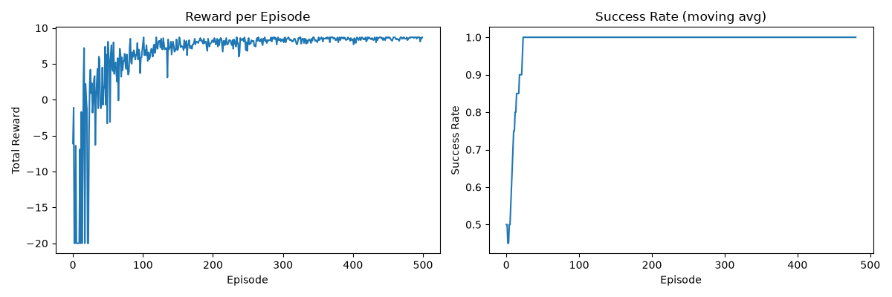
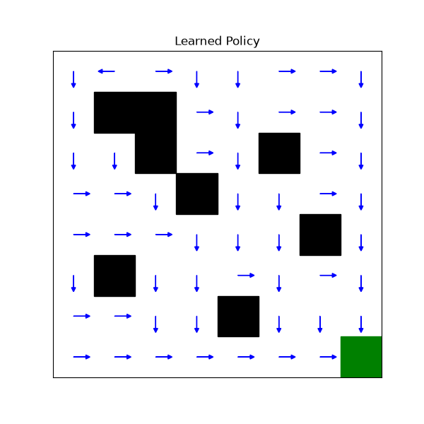
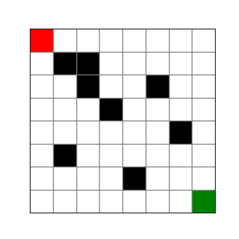

# GridWorld Q-Learning Agent

A custom Gymnasium environment where an agent learns to navigate an 8x8
maze using tabular Q-Learning.

## Environment
- 8x8 grid, agent starts at (0,0), goal at (7,7)
- Walls block movement
- Actions: up, down, left, right
- Reward: -0.1 per step, +10 on reaching goal

## Algorithm
Tabular Q-Learning with epsilon-greedy exploration.
Q(s,a) += alpha * (r + gamma * max Q(s',a') - Q(s,a))

## Results
- Success rate reaches 100% within ~400 episodes
- Agent converges to shortest path

## How to run
pip install -r requirements.txt
python train.py
python visualize.py